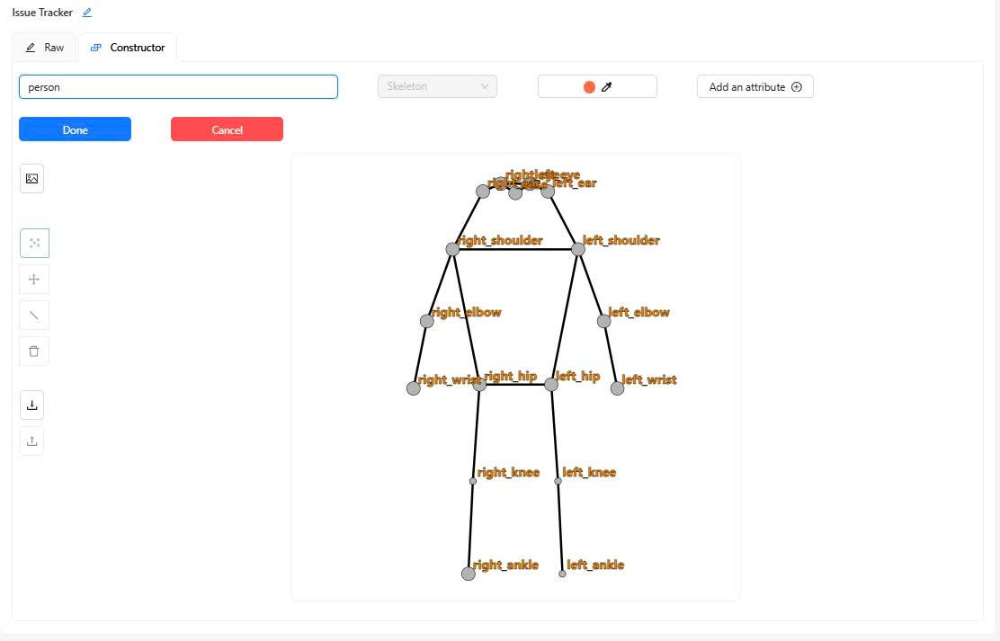
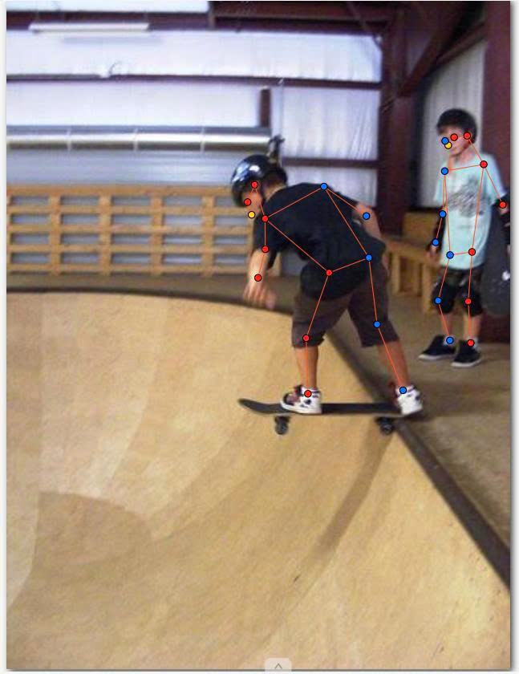
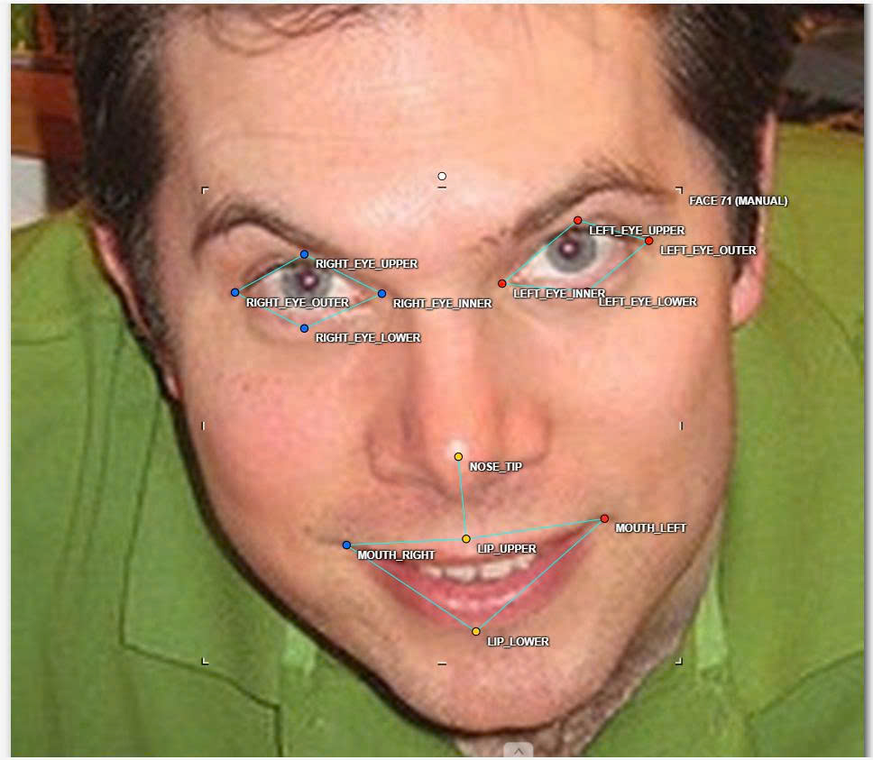
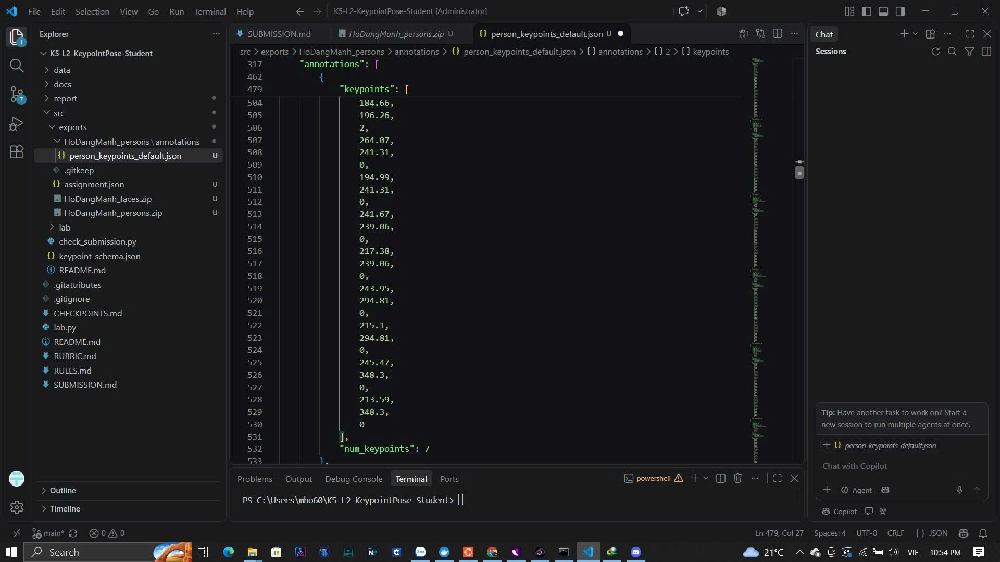

# Báo cáo cá nhân — Hồ Đăng Mạnh — 2A202603092

Dữ liệu: 12 ảnh người COCO val2017 (Lin et al., 2014) và 8 ảnh chân dung Wikimedia Commons, chỉ dùng trong lớp.

## 0. Thông tin học viên

- Họ tên: Hồ Đăng Mạnh
- MSSV: 2A202603092
- Email: mho60471@gmail.com
- Link repository: https://github.com/manhdepzai123/K5-L2-DAY04-HoDangManh-2A202603092-KeypointPose
- Phiên bản CVAT: 2.80.0
- Máy: Windows · RAM 8 GB · chạy CVAT chế độ đầy đủ (Full)
- Bộ ảnh (`src/exports/assignment.json` do `lab.py setup` tạo): Có
- Giờ bắt đầu: 17:00, ngày 12/11/2026
- Giờ kết thúc: 07:00, ngày 13/11/2026

## 1. Kiểm tra label (CP0)

| Label | Kiểu | Số điểm | Tên điểm đúng bảng của lab? | Đúng thứ tự? | Số cạnh |
|---|---|---:|---|---|---:|
| `person` | Skeleton | 17 | Có | Có | 19 |
| `face` | Skeleton | 13 | Có | Có | 13 |

Mẫu `person` dựng theo người quay mặt về camera (các điểm `left_*` nằm bên phải khung mẫu)?

Có. Mẫu Skeleton `person` được dựng theo tư thế người quay mặt về camera. Các điểm `left_*` nằm ở phía bên phải hình mẫu khi quan sát trên màn hình, phù hợp quy tắc xác định trái/phải theo cơ thể người được gán nhãn.

Kết quả kiểm tra:

Tôi đã đối chiếu cấu hình nhãn trong CVAT với file `src/keypoint_schema.json`. Kết quả xác nhận:

- Nhãn `person` gồm 17 keypoint, 19 cạnh nối, đúng tên và đúng thứ tự theo chuẩn COCO.
- Nhãn `face` gồm 13 keypoint, 13 cạnh nối, đúng tên và đúng thứ tự theo bộ điểm khuôn mặt của bài thực hành.

## 2. Số lượng đã gán và thời gian (CP1, CP2)

| Nhóm ảnh | Số ảnh | Số skeleton đã gán | Số người dưới 60 px (không gán) | Số poster / gương / màn hình bỏ qua | Thời gian (phút) |
|---|---:|---:|---|---:|---:|
| `easy` | 5 | 5 | Chưa thống kê theo nhóm | 0 | ≈ 20 |
| `occluded` | 3 | 6 | Chưa thống kê theo nhóm | 0 | ≈ 20 |
| `back` | 2 | 4 | Chưa thống kê theo nhóm | 0 | ≈ 20 |
| `small` | 1 | 4 | Chưa thống kê theo nhóm | 0 | ≈ 20 |
| `crowd` | 1 | 2 | Chưa thống kê theo nhóm | 0 | ≈ 20 |
| `faces` | 8 | 8 | — | 0 | ≈ 20 |
| Tổng cộng | 20 | 29 | 5 người (chưa phân nhóm) | 0 | ≈ 120 |

Kết quả thực hiện:

- Tổng số ảnh được giao: 20 ảnh, gồm 12 ảnh người và 8 ảnh khuôn mặt.
- Tổng số Skeleton đã gán: 29 Skeleton, trong đó có 21 Skeleton `person` và 8 Skeleton `face`.
- Tổng số người dưới 60 px không gán nhãn: 5 người. Chưa ghi nhận được số lượng cụ thể theo từng nhóm ảnh.
- Số đối tượng trên poster, trong gương hoặc trên màn hình bỏ qua: 0 trường hợp.
- Số ảnh người đã hoàn thành ở mốc phút 105: 9/10 ảnh.

Thời gian thực tế (ước tính):

- CP1 – Gán nhãn 12 ảnh người: khoảng 100 phút.
- CP2 – Gán nhãn 8 ảnh khuôn mặt: khoảng 20 phút.
- CP3 – Tự kiểm tra và rà soát nhãn: 2 phút.

Tổng thời gian thực hiện CP1, CP2 và CP3 ước tính khoảng 122 phút, chưa tính thời gian chuẩn bị môi trường, khắc phục lỗi kỹ thuật, xuất dữ liệu và nghỉ giữa các giai đoạn.

Ảnh tốn thời gian nhất:

Ảnh `000000572411.jpg` là ảnh tôi gặp nhiều khó khăn nhất trong quá trình gán nhãn. Trong ảnh có nhiều người ở khoảng cách xa, kích thước nhỏ và một số bộ phận cơ thể bị thành toa tàu che khuất. Điều này gây khó khăn khi xác định chính xác vị trí các keypoint, đặc biệt là những điểm thuộc phần thân dưới và chân.

Tôi cần quan sát kỹ và phóng to ảnh để phân biệt các điểm có thể xác định được với các điểm không đủ thông tin để gán nhãn.

Khi xuất dữ liệu, chương trình tự kiểm cũng ghi nhận hai cảnh báo ở ảnh này do vùng keypoint của hai Skeleton có chiều cao lần lượt là 26 px và 24 px. Tôi đã kiểm tra lại ảnh trong CVAT và ghi nhận tình trạng che khuất để giải thích trong Mục 5 của báo cáo.

## 3. Bảng ca khó (CP1, CP2)

| Ảnh | Người / mặt | Điểm | Cờ đã chọn | Phân vân giữa | Lý do chọn |
|---|---|---|---:|---|---|
| `face_255797.jpg` | Khuôn mặt đeo kính râm | `left_eye_outer` | 0 | `v=0` và `v=1` | Kính râm che khuất mắt khiến tôi không xác định chắc chắn vị trí keypoint. Vì vậy, tôi chọn `outside (v=0)` thay vì ước lượng vị trí thiếu chính xác. |
| `000000572411.jpg` | Người #1 trong toa tàu | `left_knee` | 0 | `v=0` và `v=1` | Thành toa tàu che khuất phần chân và đầu gối, khiến tôi khó xác định chính xác vị trí khớp. Tôi chọn `outside (v=0)` vì không đủ thông tin để xác định vị trí điểm. |
| `000000521817.jpg` | Người #2 đứng bên phải, quay nửa lưng | `right_shoulder` | 2 | `left_shoulder` và `right_shoulder` | Người có thân quay nửa lưng nhưng đầu ngoái lại nhìn camera, khiến tôi dễ nhầm vai trái và vai phải. Tôi xác định bên trái và bên phải theo cơ thể người trong ảnh, không theo hướng nhìn của người quan sát. |

Nhận xét:

Ba trường hợp khó tập trung vào việc xác định vị trí điểm bị che khuất và phân biệt trái/phải khi tư thế người thay đổi. Qua quá trình gán nhãn, tôi nhận thấy cần quan sát hướng cơ thể, kiểm tra đường nối Skeleton và lựa chọn cờ hiển thị dựa trên mức độ chắc chắn về vị trí keypoint.

## 4. Bảng tự review (CP3)

Tôi tiến hành tự kiểm tra 5 ảnh người và 3 ảnh khuôn mặt, theo thứ tự từ ảnh cuối về ảnh đầu. Quá trình kiểm tra tập trung vào vị trí các keypoint, quy tắc trái/phải, cờ visibility và số lượng Skeleton trong ảnh.

| Ảnh | Người / mặt | Điểm | Mã lỗi | Ghi chú | Đã sửa? |
|---|---|---|---|---|---|
| `000000572411.jpg` | 4 người trong toa tàu | Các điểm chân bị che khuất | `ok` | Đã kiểm tra lại 4 Skeleton, không phát hiện lỗi cần sửa. Giữ nguyên dữ liệu gán nhãn. | Không cần |
| `000000521817.jpg` | Người #2 đứng bên phải, quay nửa lưng | `left_elbow` | `ok` | Đã kiểm tra vị trí khuỷu tay trái và xác nhận phù hợp, không phát hiện lỗi cần sửa. | Không cần |
| `000000431988.jpg` | Người trượt ván, quay nửa lưng | Vai, khuỷu tay, hông và đầu gối | `ok` | Đã kiểm tra vị trí keypoint, hướng trái/phải và đường nối Skeleton. Không phát hiện lỗi cần sửa. | Không cần |
| `000000381889.jpg` | Người đàn ông đội mũ đen ở hậu cảnh | Toàn bộ Skeleton `person` | `missing` | Phát hiện một người ở hậu cảnh chưa được gán Skeleton. Ban đầu tôi cho rằng người này không đủ điều kiện gán nhãn. Sau khi rà soát, tôi quyết định giữ nguyên dữ liệu và không bổ sung Skeleton. | Không |
| `000000043500.jpg` | Hai người tại cửa toa tàu | Vai, tay, đầu gối và cổ chân | `ok` | Đã kiểm tra vị trí keypoint, đường nối Skeleton và các điểm bị che khuất. Không phát hiện lỗi cần sửa. | Không cần |
| `face_442231.jpg` | Khuôn mặt nam | `lip_lower` | `ok` | Đã kiểm tra lại vị trí điểm môi dưới và xác nhận phù hợp. Không phát hiện lỗi cần sửa. | Không cần |
| `face_436791.jpg` | Khuôn mặt nam đang cầm điện thoại | `mouth_right` | `ok` | Đã kiểm tra lại vị trí các điểm vùng miệng. Không phát hiện lỗi cần sửa, giữ nguyên Skeleton. | Không cần |
| `face_255797.jpg` | Khuôn mặt nữ đeo kính râm | 8 điểm thuộc hai mắt | `vis_flag` | Tám điểm mắt đang được đặt `outside (v=0)`. Theo quy tắc của bài, mắt bị kính râm tối che có thể cần đặt `occluded (v=1)`. Tôi ghi nhận vấn đề nhưng quyết định giữ nguyên dữ liệu. | Không |

### Tổng hợp số lỗi theo mã

| `lr_swap` | `vis_flag` | `position` | `missing` | `extra` | `ok` |
|---:|---:|---:|---:|---:|---:|
| 0 | 1 | 0 | 1 | 0 | 6 |

Nhận xét kết quả tự review:

- Tổng số lượt review: 8, gồm 5 ảnh người và 3 ảnh khuôn mặt.
- Số lượt không phát hiện lỗi: 6.
- Số trường hợp phát hiện vấn đề: 2, gồm 1 trường hợp `missing` và 1 trường hợp `vis_flag`.
- Hai vấn đề đã được ghi nhận nhưng chưa chỉnh sửa trong CVAT.

### Điểm còn phân vân giữa `v=1` và `v=0`

Trường hợp 1 – Ảnh `face_255797.jpg`:

Tôi phân vân giữa `outside (v=0)` và `occluded (v=1)` đối với các điểm mắt bị kính râm che khuất. Khi gán nhãn, tôi chọn `v=0` vì không xác định chắc chắn vị trí các điểm mắt.

Sau khi đối chiếu quy định của bài, tôi nhận thấy trường hợp kính râm tối cần xem xét sử dụng `v=1` nếu có thể ước lượng vị trí theo gọng kính. Tôi ghi nhận sự khác biệt này nhưng chưa thay đổi dữ liệu đã xuất.

Trường hợp 2 – Ảnh `000000572411.jpg`:

Tôi phân vân giữa `v=1` và `v=0` ở các điểm chân, đầu gối bị thành toa tàu che khuất. Do không xác định chắc chắn vị trí một số khớp, tôi lựa chọn `outside (v=0)` cho các điểm tương ứng.

Khi tự review, tôi giữ nguyên 4 Skeleton và ghi nhận hai cảnh báo về chiều cao vùng keypoint để giải thích riêng trong Mục 5.

## 5. Kiểm file xuất và kết quả tự kiểm (CP4)

### 5.1. Kiểm tra dữ liệu JSON xuất từ CVAT

Sau khi hoàn thành gán nhãn, tôi sử dụng lệnh `python lab.py export` để xuất dữ liệu dưới định dạng COCO Keypoints 1.0 và chạy chương trình tự kiểm.

Tôi mở các file JSON bên trong ZIP, lựa chọn hai Skeleton người và một Skeleton khuôn mặt để kiểm tra số phần tử `keypoints`, cờ visibility và giá trị `num_keypoints`.

| File | Người / mặt kiểm (ảnh, thứ tự) | Số phần tử `keypoints` | Điểm `outside` ra `v=0`, `occluded` ra `v=1`? | `num_keypoints` khớp? |
|---|---|---:|---|---|
| `HoDangManh_persons.zip` | `000000043500.jpg`, người #1, annotation ID 1 | 51 | `outside → v=0`: Có. Chưa có điểm `v=1` để kiểm tra `occluded`. | Có, 10 điểm `v>0`, `num_keypoints=10` |
| `HoDangManh_persons.zip` | `000000572411.jpg`, người #1, annotation ID 18 | 51 | `outside → v=0`: Có. Chưa có điểm `v=1` để kiểm tra `occluded`. | Có, 8 điểm `v>0`, `num_keypoints=8` |
| `HoDangManh_faces.zip` | `face_255797.jpg`, mặt #1, annotation ID 3 | 39 | `outside → v=0`: Có, gồm 8 điểm mắt. Chưa có điểm `v=1` để kiểm tra `occluded`. | Có, 5 điểm `v>0`, `num_keypoints=5` |

Kết quả đối chiếu:

- Mỗi Skeleton `person` có 17 keypoint, tương ứng 51 phần tử trong mảng `keypoints`.
- Mỗi Skeleton `face` có 13 keypoint, tương ứng 39 phần tử trong mảng `keypoints`.
- Mỗi keypoint được biểu diễn bằng bộ ba `(x, y, v)`.
- Các giá trị `num_keypoints` của ba annotation được chọn đều khớp với số điểm có `v>0`.

### 5.2. Kiểm tra cờ visibility

Theo quy ước COCO Keypoints:

- `v=2`: Điểm nhìn thấy được.
- `v=1`: Điểm bị che khuất nhưng có thể xác định vị trí.
- `v=0`: Điểm nằm ngoài ảnh hoặc không xác định được vị trí.

Theo quy tắc xuất dữ liệu, CVAT chuyển `occluded` thành `v=1` và `outside` thành `v=0`.

Tuy nhiên, trong dữ liệu thực tế của tôi chỉ xuất hiện hai giá trị `v=0` và `v=2`; không có điểm `v=1`. Vì vậy, tôi xác nhận được trường hợp `outside → v=0`, nhưng chưa thể kiểm chứng trường hợp `occluded → v=1` bằng file xuất hiện tại.

Tọa độ của điểm `outside`:

Qua kiểm tra JSON, các điểm `v=0` vẫn giữ tọa độ cũ thay vì chuyển thành `(0, 0)`.

Ví dụ, trong ảnh `face_255797.jpg`, một keypoint được xuất dưới dạng:

`[418.88, 251.86, 0]`

Điều này phù hợp với đặc điểm xuất dữ liệu của phiên bản CVAT đang sử dụng. Khi huấn luyện và đánh giá theo quy ước COCO, các điểm có `v=0` không được tính như điểm gán hợp lệ.

Trạng thái hai Job trên CVAT:

- `persons-HoDangManh` – Job #13: Completed.
- `faces-HoDangManh` – Job #14: Completed.

### 5.3. Kết quả chương trình tự kiểm

Tôi chạy lệnh:

`python lab.py export`

Sau khi xuất dữ liệu, chương trình tự động gọi `src/check_submission.py` để kiểm tra định dạng và các điều kiện của bài thực hành.

TÓM TẮT

```text
PERSON: HoDangManh_persons.zip

Số ảnh: 12
Số skeleton person: 21
Số phần tử keypoints / annotation: 51

Số skeleton theo ảnh:
000000043500.jpg: 2
000000147780.jpg: 2
000000156986.jpg: 2
000000176000.jpg: 1
000000201702.jpg: 1
000000295358.jpg: 1
000000381889.jpg: 2
000000399983.jpg: 1
000000431893.jpg: 1
000000431988.jpg: 2
000000521817.jpg: 2
000000572411.jpg: 4

Cờ visibility:
v=2: 249 (70%)
v=1: 0 (0%)
v=0: 108 (30%)

num_keypoints trung bình: 11.9


FACE: HoDangManh_faces.zip

Số ảnh: 8
Số skeleton face: 8
Số phần tử keypoints / annotation: 39

Số skeleton theo ảnh:
face_141135.jpg: 1
face_186226.jpg: 1
face_255797.jpg: 1
face_300399.jpg: 1
face_41666.jpg: 1
face_421231.jpg: 1
face_436791.jpg: 1
face_442231.jpg: 1

Cờ visibility:
v=2: 93 (89%)
v=1: 0 (0%)
v=0: 11 (11%)

num_keypoints trung bình: 11.6


Tổng số điểm v=0 còn mang tọa độ cũ: 119

Số [LỖI]: 0
Số [CẢNH BÁO]: 2

Kết quả: ĐẠT
```

*Lưu ý: Khối tóm tắt trên được trình bày lại từ số liệu thực tế đã kiểm tra. Nếu yêu cầu dán nguyên văn đầu ra chương trình, cần sao chép trực tiếp phần `TÓM TẮT` trong Terminal sau lần xuất cuối cùng.*

### 5.4. Các cảnh báo còn giữ nguyên và lý do

Chương trình tự kiểm phát hiện 2 cảnh báo, cùng xuất hiện tại ảnh `000000572411.jpg`.

| Ảnh | Skeleton | Nội dung cảnh báo |
|---|---|---|
| `000000572411.jpg` | Người #1 | Chiều cao vùng keypoint là 26 px, nhỏ hơn ngưỡng 60 px |
| `000000572411.jpg` | Người #2 | Chiều cao vùng keypoint là 24 px, nhỏ hơn ngưỡng 60 px |

Giải thích:

Tôi đã mở lại ảnh `000000572411.jpg` trên CVAT để kiểm tra.

Trong ảnh có bốn người được gán Skeleton, phần lớn đang ở trong các toa tàu. Một số người bị thành toa che khuất phần thân dưới, khiến vùng keypoint có thể quan sát được nhỏ hơn kích thước cơ thể thực tế.

Do đó, chiều cao vùng keypoint 26 px và 24 px chưa đủ để kết luận chắc chắn toàn bộ cơ thể của hai người đều cao dưới 60 px.

Sau khi xem lại ảnh, tôi quyết định giữ nguyên bốn Skeleton và ghi nhận hai cảnh báo trong báo cáo.

### 5.5. Những hạn chế đã phát hiện khi tự review

Trường hợp khuôn mặt đeo kính râm – `face_255797.jpg`:

Trong ảnh này, 8 điểm thuộc hai mắt được xuất với cờ `v=0`, trong khi 5 điểm còn lại thuộc vùng mũi và miệng có cờ `v=2`.

Khi gán nhãn, tôi lựa chọn `v=0` do kính râm che khuất mắt và tôi không xác định chắc chắn vị trí các keypoint.

Sau khi đối chiếu guideline, tôi nhận thấy các điểm mắt bị kính râm tối che cần xem xét sử dụng `occluded (v=1)` khi có thể ước lượng chắc vị trí. Tôi ghi nhận hạn chế này nhưng quyết định giữ nguyên dữ liệu.

Trường hợp người ở hậu cảnh – `000000381889.jpg`:

Khi tự review, tôi phát hiện người đàn ông đội mũ đen ở hậu cảnh chưa được gán Skeleton.

Tôi quyết định không bổ sung Skeleton cho đối tượng này và ghi nhận trường hợp chưa sửa trong Mục 4 của báo cáo.

### 5.6. Kết luận

Sau khi xuất và kiểm tra dữ liệu, chương trình trả về kết quả **ĐẠT, với 0 lỗi và 2 cảnh báo**.

Hai file xuất có đủ 12 ảnh người và 8 ảnh khuôn mặt, đúng số phần tử keypoint của từng loại Skeleton. Các annotation được chọn để đối chiếu có giá trị `num_keypoints` chính xác.

Tuy nhiên, kết quả tự kiểm đạt yêu cầu định dạng không có nghĩa tất cả vị trí keypoint và cờ visibility đều chính xác. Tôi đã ghi nhận những hạn chế chưa chỉnh sửa để phản ánh trung thực chất lượng dữ liệu gán nhãn.

## 6. Ảnh chụp màn hình

Ảnh 1 – Kiểm tra cấu trúc Skeleton `person`

Ảnh chụp giao diện Label Constructor trong CVAT, thể hiện nhãn `person` với đầy đủ 17 keypoint, tên các điểm và hệ thống đường nối Skeleton.



Ảnh 2 – Gán nhãn người quay lưng

Ảnh minh chứng quá trình gán nhãn Skeleton `person` cho người quay lưng hoặc quay nửa lưng, thể hiện cách xác định các điểm trái/phải theo cơ thể người trong ảnh.



Ảnh 3 – Gán nhãn khuôn mặt với 13 keypoint

Ảnh chụp một khuôn mặt đã gán Skeleton `face`, thể hiện các điểm quanh mắt, mũi và miệng. Vùng mắt được phóng to để thuận tiện kiểm tra vị trí keypoint.



Ảnh 4 – Kiểm tra dữ liệu JSON sau khi xuất

Ảnh chụp dữ liệu COCO Keypoints 1.0 trong Visual Studio Code, thể hiện mảng `keypoints` và trường `num_keypoints` của một annotation `person`.



**Nguồn ảnh:** COCO val2017 (Lin et al., 2014) / Wikimedia Commons; sử dụng phục vụ học tập trong phạm vi lớp.

## 7. Tự đánh giá

1. Lỗi tôi mắc nhiều nhất hôm nay và cách tránh trong dự án thực tế

Khó khăn tôi thường gặp nhất là phân biệt giữa `outside (v=0)` và `occluded (v=1)`, đặc biệt ở những vị trí như đầu gối và khuỷu tay khi bị che khuất.

Để hạn chế lỗi này, tôi sẽ kiểm tra kỹ từng vị trí khớp và phóng to ảnh khi cần thiết. Nếu điểm bị che nhưng vẫn có thể xác định chắc chắn vị trí, tôi chọn `occluded (v=1)`. Nếu điểm nằm ngoài ảnh hoặc không đủ căn cứ để xác định, tôi chọn `outside (v=0)`.

2. Một quy tắc tôi đề xuất bổ sung vào guideline

Trước khi hoàn thành mỗi Skeleton `person`, cần rà soát đầy đủ 17 keypoint, đặc biệt chú ý các vị trí khuỷu tay, đầu gối và cổ chân.

Đối với những điểm bị che khuất, cần kiểm tra kỹ cờ visibility, không tự ý đặt keypoint vào vị trí suy đoán chỉ để hoàn thành Skeleton.

Ví dụ: Trong ảnh `000000572411.jpg`, thành toa tàu che khuất phần chân của một số người, gây khó khăn khi xác định vị trí đầu gối và cổ chân.

3. Một lỗi tôi đã sửa và ảnh hưởng của lỗi đến quá trình huấn luyện model

Trong quá trình gán nhãn, tôi từng đặt sai vị trí một keypoint đầu gối (`knee`) và đã điều chỉnh lại điểm này.

Trong bài toán ước lượng tư thế, tọa độ keypoint được sử dụng làm nhãn mục tiêu khi huấn luyện. Đối với các model dự đoán heatmap, vị trí đầu gối được dùng để tạo vùng mục tiêu trên heatmap.

Nếu điểm đầu gối bị đặt sai và vẫn được tính vào quá trình huấn luyện (`v>0`), heatmap mục tiêu sẽ lệch khỏi vị trí khớp thực tế. Khi tính hàm mất mát (loss), model có thể bị hướng tới việc dự đoán vị trí sai đó.

Việc chỉnh sửa keypoint về đúng vị trí giúp cải thiện chất lượng nhãn huấn luyện, giảm nguy cơ model học sai vị trí khớp và nâng cao độ chính xác khi dự đoán tư thế.


## 8. Khó khăn và lỗi kỹ thuật

Trong quá trình thực hiện bài thực hành Day 04 – KeypointPose, tôi gặp một số khó khăn sau:

1. Khó khăn khi gán nhãn Skeleton

Một số ảnh có người ở khoảng cách xa, kích thước nhỏ hoặc bị vật thể che khuất. Điều này khiến việc xác định vị trí chính xác của các keypoint, đặc biệt là khuỷu tay, đầu gối và cổ chân, gặp nhiều khó khăn.

Điển hình là ảnh `000000572411.jpg`, trong đó một số người bị thành toa tàu che khuất phần thân dưới.

2. Khó khăn khi sử dụng cờ visibility

Tôi gặp khó khăn trong việc phân biệt `outside (v=0)` và `occluded (v=1)` đối với những điểm bị che khuất.

Ở ảnh `face_255797.jpg`, kính râm che vùng mắt khiến tôi không xác định chắc chắn vị trí keypoint. Tôi đã chọn `v=0` và giữ nguyên dữ liệu sau khi kiểm tra lại.

3. Khó khăn khi thao tác trong Visual Studio Code

Trong quá trình cập nhật địa chỉ GitHub, tôi đã sao chép nhầm nội dung không phải lệnh vào PowerShell, khiến Terminal xuất hiện thông báo lỗi.

Sau đó, tôi khắc phục bằng cách nhập đúng lệnh Git và sử dụng `git remote -v` để xác nhận repository đã được cập nhật chính xác.

4. Cảnh báo khi xuất dữ liệu

Khi chạy lệnh `python lab.py export`, chương trình tự kiểm trả về 0 lỗi và 2 cảnh báo.

Hai cảnh báo xuất hiện tại ảnh `000000572411.jpg`, liên quan đến hai Skeleton có chiều cao vùng keypoint là 26 px và 24 px, nhỏ hơn ngưỡng 60 px.

Tôi đã mở lại ảnh trên CVAT để kiểm tra, nhận thấy một số người bị che khuất phần lớn cơ thể. Tôi quyết định giữ nguyên dữ liệu và giải thích hai cảnh báo trong Mục 5.

5. Kết quả xử lý

Sau khi hoàn thành gán nhãn và xuất dữ liệu, chương trình tự kiểm trả về kết quả **ĐẠT – 0 lỗi, 2 cảnh báo**.

Các vấn đề chưa chỉnh sửa đã được ghi nhận trong bảng tự review để phản ánh trung thực kết quả thực hành.

## Bonus (nếu làm)

Tôi không thực hiện các nội dung Bonus B1, B2 và B3 trong bài thực hành này.

Tôi tập trung hoàn thành các nhiệm vụ chính từ CP0 đến CP4, bao gồm kiểm tra cấu trúc Skeleton, gán nhãn 12 ảnh người và 8 ảnh khuôn mặt, tự review, xuất dữ liệu COCO Keypoints và chạy chương trình tự kiểm.

---

## 9. Tài liệu tham khảo và công cụ AI đã dùng

### 9.1. Tài liệu tham khảo

1. `README.md` – Hướng dẫn tổng quan bài thực hành Day 04 – KeypointPose.
2. `RULES.md` – Quy định thực hiện bài, sử dụng AI và nguyên tắc gán nhãn.
3. `CHECKPOINTS.md` – Hướng dẫn thực hiện các giai đoạn CP0 đến CP4.
4. `RUBRIC.md` – Tiêu chí đánh giá chất lượng gán nhãn và bài báo cáo.
5. `SUBMISSION.md` – Quy định về cấu trúc thư mục, tên file và cách nộp bài.
6. `docs/GUIDELINE.md` – Quy tắc gán nhãn keypoint, xác định trái/phải và cờ visibility.
7. `docs/COCO_KEYPOINTS.md` – Hướng dẫn đọc định dạng COCO Keypoints.
8. `src/keypoint_schema.json` – Cấu trúc 17 keypoint người và 13 keypoint khuôn mặt.
9. Lin, T.-Y. và cộng sự (2014), *Microsoft COCO: Common Objects in Context*.

### 9.2. Các công cụ sử dụng

| Công cụ | Mục đích sử dụng |
|---|---|
| CVAT 2.80.0 | Gán nhãn Skeleton `person` và `face`, kiểm tra các keypoint |
| Visual Studio Code | Quản lý mã nguồn, xem dữ liệu JSON và viết báo cáo Markdown |
| Python – `lab.py` | Thiết lập task, xuất dữ liệu từ CVAT |
| `src/check_submission.py` | Kiểm tra dữ liệu và phát hiện lỗi, cảnh báo |
| Git và GitHub | Quản lý phiên bản và lưu trữ repository bài nộp |
| ChatGPT (OpenAI) | Hỗ trợ giải thích kiến thức kỹ thuật, hướng dẫn thao tác, phân tích cảnh báo và chỉnh sửa cách trình bày báo cáo |

### 9.3. Phạm vi sử dụng AI

Trong quá trình thực hiện, tôi sử dụng ChatGPT làm công cụ hỗ trợ học tập và giải đáp các vấn đề kỹ thuật.

Các nội dung được hỗ trợ gồm:

- Giải thích cách xác định keypoint, quy tắc trái/phải và các giá trị visibility `v=0`, `v=1`, `v=2`.
- Hướng dẫn thao tác CVAT, Visual Studio Code và các lệnh Git.
- Giải thích kết quả tự kiểm và các cảnh báo khi xuất dữ liệu.
- Hỗ trợ chỉnh sửa câu chữ, định dạng bảng và tổ chức nội dung báo cáo.

Các quyết định gán nhãn và phần tự đánh giá được xác nhận dựa trên quá trình thực hành của tôi. ChatGPT không được sử dụng để tự động sinh tọa độ keypoint đưa vào dữ liệu nộp bài.